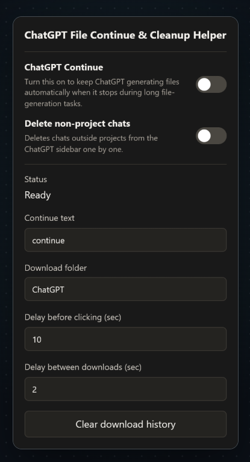

# ChatGPT File Continue & Cleanup Helper

A Chrome and Brave extension for ChatGPT conversations that produce files over several replies. It downloads files one at a time, waits for the batch to finish, then sends a follow-up message such as `continue`. A separate, optional mode cleans up conversations outside projects.

<p align="center">
  
</p>

## Install

1. Clone this repository or choose **Code → Download ZIP** on GitHub and extract the archive.
2. Open `chrome://extensions` in Chrome or `brave://extensions` in Brave. Enable **Developer mode**.
3. Choose **Load unpacked** and select the folder containing `manifest.json`.
4. Open or reload a ChatGPT conversation, then open the extension from the browser toolbar.

Both automation switches start off after installation or an extension update. Settings apply across ChatGPT tabs in the same browser profile.

## Download files and continue

Turn on **ChatGPT Continue** in the extension popup. Once ChatGPT finishes responding, the extension looks for downloadable files in the conversation, starting with the most recent reply. It processes one batch in order and sends your configured text after the last download finishes. The popup’s **Status** shows what it is waiting for.

| Setting | Default | What it controls |
| --- | --- | --- |
| Continue text | `continue` | Message sent to the conversation after the batch finishes. |
| Download folder | `ChatGPT` | Subfolder under your browser’s downloads directory for direct downloads. Files saved through a page control follow the browser’s download settings. |
| Delay before clicking | 10 seconds | Wait before starting a batch. Increase this if a file link appears before the file is ready. |
| Delay between downloads | 2 seconds | Wait between files and before sending the follow-up message. |

## Clean up conversations

**Delete non-project chats** acts on the signed-in account’s conversation list, including chats other than the one currently open. While enabled, cleanup takes priority over downloads and processes one conversation at a time without asking you to confirm each one.

The extension remembers the IDs of project chats it encounters in the current tab and skips them on later passes. It asks ChatGPT to hide one eligible conversation by its ID. If the list has no eligible chat, the extension can check links in an English sidebar. It acts on a sidebar link only when ChatGPT returns the same conversation ID and explicitly reports no project membership. Chats with missing or conflicting details are skipped. Turn the switch off to stop further cleanup.

## Local data and privacy

The extension runs on `chatgpt.com` and `chat.openai.com`. Cleanup uses your existing ChatGPT session. The extension stores settings, the latest status and up to 500 download-history entries in your browser profile. These entries can include file labels, full download URLs and conversation paths. **Clear download history** resets the extension’s download records. Files already saved to disk stay in place.

Console output can contain file labels and download links. Remove private details before sharing logs in a bug report.

## Tests

From the repository root, run the automated tests with Node.js 24.

```sh
node --test
```

The tests use simulated conversations and downloads to check cleanup, download order, duplicate detection and retries. [View the test report](tests/README.md).
